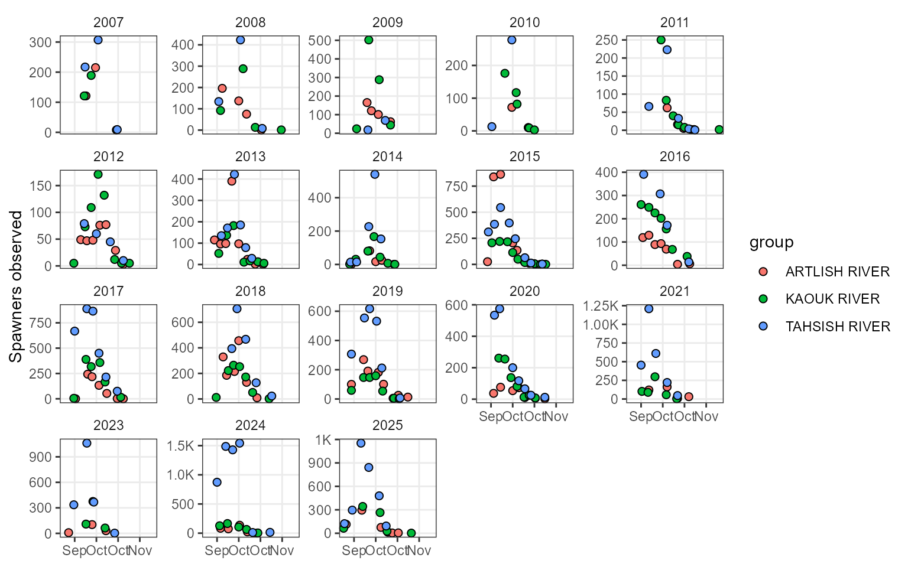
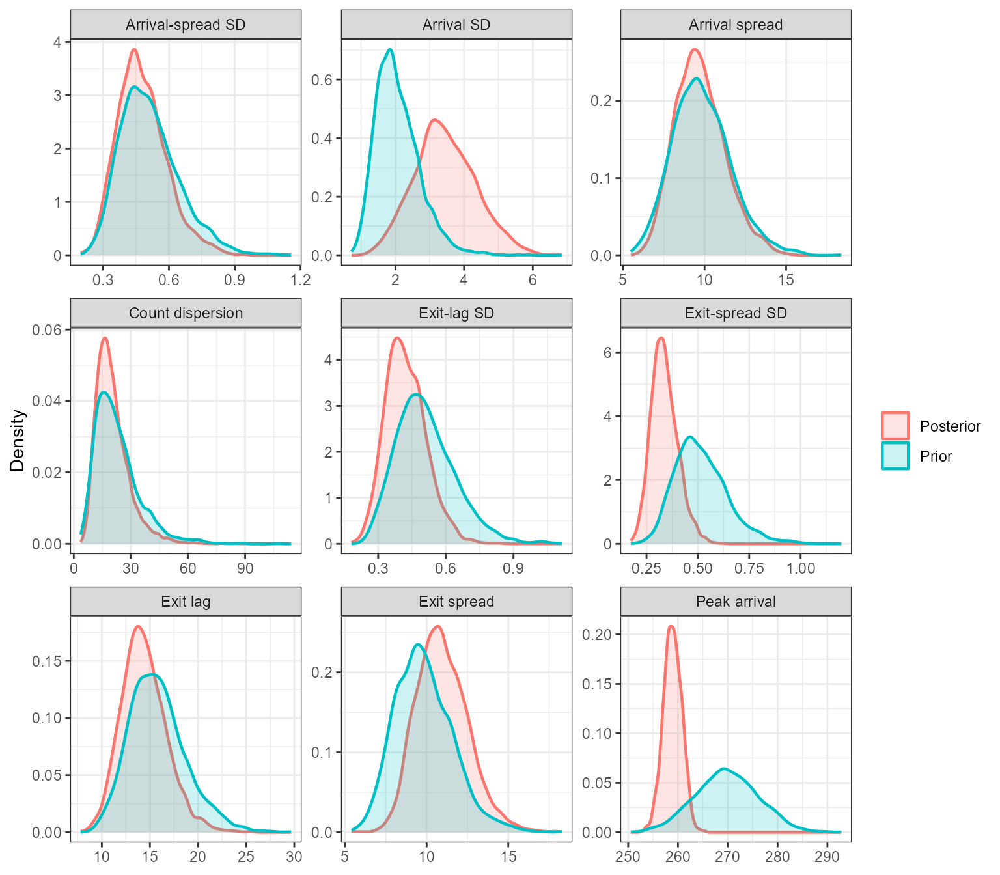
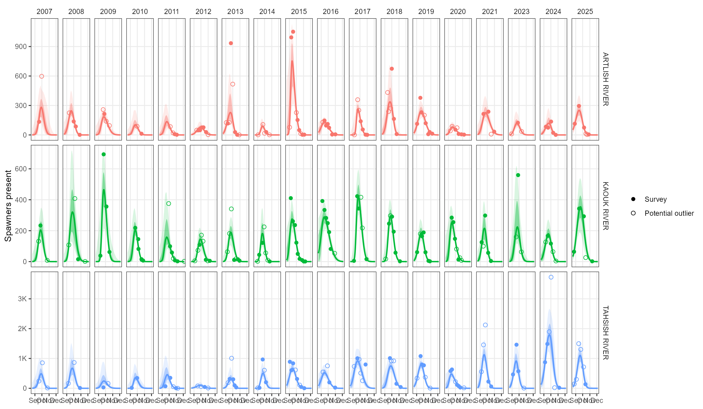
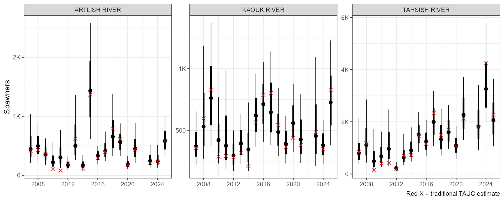
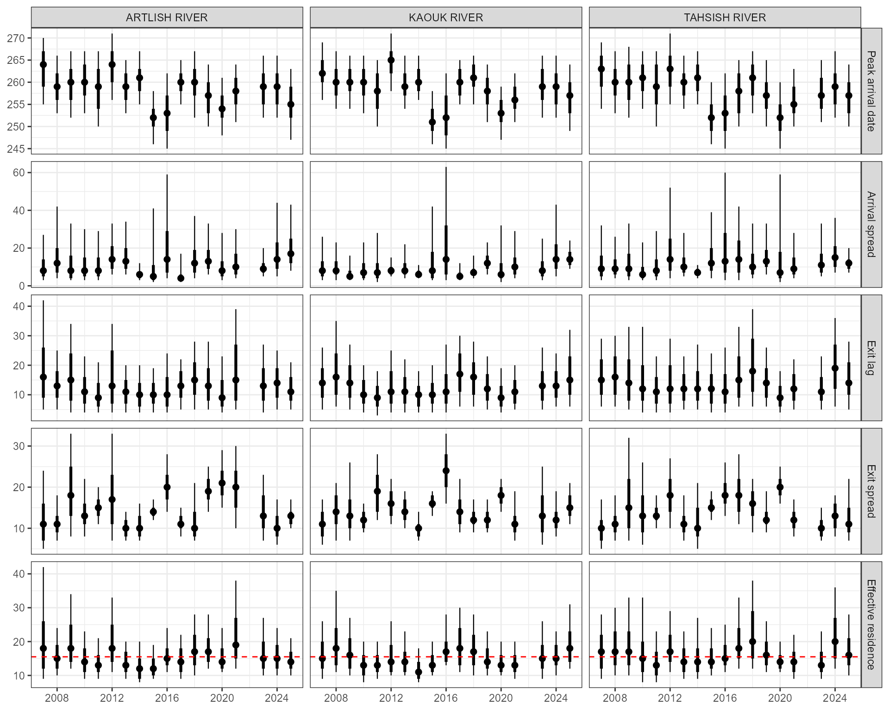

# Multi-Population Analyses in spawnBayes

``` r
library(spawnBayes)
library(ggplot2)
library(dplyr)
library(lubridate)

knitr::opts_chunk$set(
  collapse = TRUE,
  comment = "#>",
  warning = FALSE,
  message = FALSE
)
```

## Introduction

In many monitoring programs, salmon abundance is assessed simultaneously
across multiple rivers, reaches, or index areas. When populations
exhibit similar seasonal timing patterns, analysing groups jointly can
improve estimation in years with sparse survey coverage while retaining
separate abundance estimates for each group.

This vignette demonstrates the multi-group capabilities of spawnBayes
using Chinook salmon survey data from the Artlish, Kaouk, and Tahsish
rivers on northwest Vancouver Island. The same dataset is used in the
[Getting Started with
spawnBayes](https://sire-p.github.io/spawnBayes/articles/getting-started.md)
vignette, where only Artlish River is analysed.

## Example data

The dataset contains survey observations from three rivers. Groups
represent the units for which abundance and timing are estimated
separately.

``` r
data("nvi_chinook")

summary(nvi_chinook)
#>       date               stream             group           spawner_counts   
#>  Min.   :2007-09-18   Length:292         Length:292         Min.   :   1.00  
#>  1st Qu.:2012-11-06   Class :character   Class :character   1st Qu.:  13.75  
#>  Median :2016-09-28   Mode  :character   Mode  :character   Median :  82.00  
#>  Mean   :2016-12-10                                         Mean   : 168.80  
#>  3rd Qu.:2020-09-18                                         3rd Qu.: 215.50  
#>  Max.   :2025-11-12                                         Max.   :1543.00  
#>  observer_efficiency survey_error_group
#>  Min.   :0.3067      Length:292        
#>  1st Qu.:0.8610      Class :character  
#>  Median :0.9348      Mode  :character  
#>  Mean   :0.9058                        
#>  3rd Qu.:1.0000                        
#>  Max.   :1.0000
```

## Validate data

The first step is to validate and standardize the input data. This
converts the dates into their proper format and converts observer
efficiency and coverage to proportions if they were provided as
percentages. Validation may generate warnings if missing correction
factors are supplied or if some years show potential evidence of
multiple run peaks.

``` r
nvi_chinook <- validate_data(nvi_chinook)

summary(nvi_chinook)
#>       date               stream                    group     spawner_counts   
#>  Min.   :2007-09-18   Length:292         ARTLISH RIVER: 98   Min.   :   1.00  
#>  1st Qu.:2012-11-06   Class :character   KAOUK RIVER  :107   1st Qu.:  13.75  
#>  Median :2016-09-28   Mode  :character   TAHSISH RIVER: 87   Median :  82.00  
#>  Mean   :2016-12-10                                          Mean   : 168.80  
#>  3rd Qu.:2020-09-18                                          3rd Qu.: 215.50  
#>  Max.   :2025-11-12                                          Max.   :1543.00  
#>  observer_efficiency survey_error_group    coverage
#>  Min.   :0.3067      HIGH   :217        Min.   :1  
#>  1st Qu.:0.8610      LOW    :  7        1st Qu.:1  
#>  Median :0.9348      MED    : 30        Median :1  
#>  Mean   :0.9058      UNKNOWN: 38        Mean   :1  
#>  3rd Qu.:1.0000                         3rd Qu.:1  
#>  Max.   :1.0000                         Max.   :1
```

## Survey observations

Now plot the raw survey counts by date in each year.

``` r
ggplot(nvi_chinook |> mutate(year = year(date), day = yday(date)),
  aes(x = day, y = spawner_counts, fill = group))+
  geom_point(pch = 21, size = 2) +
  facet_wrap(~year, scales = "free_y")+
  theme_bw() +
    theme(
      strip.background = element_blank(),
      panel.grid.minor = element_blank()
    ) +
    scale_y_continuous(
      labels = scales::label_number(
        scale_cut = scales::cut_short_scale()
      ),
      name = "Spawners observed"
    ) +
    scale_x_continuous(
      labels = function(x)
        format(
          as.Date(x, origin = "2023-12-31"),
          "%b"
        ),
      name = NULL
    )
```



## Fit the model

Unlike the single-population analysis presented in the introductory
vignette, this model is fit to all three rivers simultaneously.
Abundance is estimated separately for each group, but information about
seasonal timing is shared hierarchically among groups. This structure
can improve estimation in years where individual groups have sparse
survey coverage.

``` r
fit <- fit_spawner(nvi_chinook, iter_warmup = 500, iter_sampling = 500, assumed_residence = 15.5, adapt_delta = 0.99, refresh = 0)
#> Running MCMC with 4 parallel chains...
#> Chain 1 finished in 278.5 seconds.
#> Chain 2 finished in 288.3 seconds.
#> Chain 3 finished in 356.8 seconds.
#> Chain 4 finished in 381.0 seconds.
#> 
#> All 4 chains finished successfully.
#> Mean chain execution time: 326.2 seconds.
#> Total execution time: 381.4 seconds.
```

## Model diagnostics

As with single-population analyses, model convergence should be assessed
using Rhat, effective sample sizes, divergent transitions, and
tree-depth warnings. All diagnostic checks were acceptable in this
example.

``` r
diagnostics(fit)
#>   converged    quality divergences treedepth_hits max_rhat min_ess_bulk
#> 1      TRUE acceptable           0            781     1.01          385
#>   min_ess_tail                     recommendation
#> 1          636 Consider increasing max_treedepth.
```

## Prior-posterior comparisons

Prior-posterior comparisons provide a useful diagnostic for assessing
the extent to which parameter estimates are informed by the data. See
the vignette [Getting Started with
spawnBayes](https://sire-p.github.io/spawnBayes/articles/getting-started.md)
for more information.

``` r
prior_post_plot(fit)
```



## Estimated run

The fitted curves represent the estimated number of spawners present
through time. Shaded regions show the 66 and 95% credible intervals.
Observed survey counts are shown as points. When the outlier model is
enabled, open circles indicate surveys with posterior outlier
probabilities exceeding 0.25. These surveys show greater conflict with
the fitted run-timing and observation model than expected under the
primary observation process. Survey observations are plotted after
deterministic correction for observer efficiency and survey coverage to
facilitate comparison with the estimated number of spawners present.

``` r
plot_run_curve(fit,facet = "group_year")
```



## Outlier diagnostics

`spawnBayes` can identify surveys that deviate substantially from the
overall run-timing pattern. These observations are not removed from the
analysis; instead, the model estimates the probability that they arise
from a higher-variance observation process and correspondingly reduces
their influence on parameter estimation.

Surveys with elevated outlier probabilities may reflect counting errors,
unusual survey conditions, inaccuracies in correction factors, or
biological patterns that are not fully captured by the run-timing model.
Elevated outlier probabilities do not necessarily indicate erroneous
data. Rather, they identify observations that are difficult to reconcile
with the fitted observation and run-timing processes.

Users are encouraged to inspect years containing surveys with high
outlier probabilities and assess whether the fitted run-timing model is
appropriate for estimating spawner abundance.

## Abundance estimates

Because abundance is estimated separately for each group, the resulting
summaries can be used to compare population trajectories among rivers.
In this example, the three rivers exhibit substantial variation in
abundance among years, despite occurring within the same geographic
region.

``` r
abund <- abundance(fit)
knitr::kable(abund)
```

| group | year | median | lwr_95 | lwr_66 | upr_66 | upr_95 | TAUC | pct_diff_TAUC | multimodal | n_outliers |
|:---|---:|---:|---:|---:|---:|---:|---:|---:|:---|---:|
| ARTLISH RIVER | 2007 | 443 | 209 | 307 | 663 | 1036 | 415 | 6.7 | FALSE | 1 |
| ARTLISH RIVER | 2008 | 496 | 229 | 357 | 662 | 908 | 426 | 16.4 | FALSE | 1 |
| ARTLISH RIVER | 2009 | 355 | 178 | 253 | 476 | 624 | 361 | -1.7 | FALSE | 3 |
| ARTLISH RIVER | 2010 | 220 | 97 | 147 | 334 | 563 | 101 | 117.8 | FALSE | 1 |
| ARTLISH RIVER | 2011 | 303 | 120 | 200 | 471 | 762 | 80 | 278.8 | FALSE | 2 |
| ARTLISH RIVER | 2012 | 172 | 89 | 119 | 231 | 317 | 183 | -6.0 | FALSE | 2 |
| ARTLISH RIVER | 2013 | 498 | 261 | 344 | 861 | 1356 | 619 | -19.5 | FALSE | 4 |
| ARTLISH RIVER | 2014 | 169 | 72 | 120 | 233 | 344 | 113 | 49.6 | FALSE | 4 |
| ARTLISH RIVER | 2015 | 1431 | 612 | 992 | 1937 | 2580 | 1367 | 4.7 | FALSE | 3 |
| ARTLISH RIVER | 2016 | 329 | 189 | 259 | 406 | 498 | 289 | 13.8 | FALSE | 1 |
| ARTLISH RIVER | 2017 | 414 | 238 | 312 | 550 | 741 | 394 | 5.1 | FALSE | 3 |
| ARTLISH RIVER | 2018 | 654 | 327 | 464 | 935 | 1378 | 792 | -17.4 | FALSE | 3 |
| ARTLISH RIVER | 2019 | 561 | 326 | 432 | 705 | 879 | 612 | -8.3 | FALSE | 1 |
| ARTLISH RIVER | 2020 | 185 | 103 | 141 | 242 | 330 | 170 | 8.8 | FALSE | 3 |
| ARTLISH RIVER | 2021 | 451 | 213 | 313 | 616 | 887 | 434 | 3.9 | FALSE | 1 |
| ARTLISH RIVER | 2023 | 243 | 118 | 170 | 344 | 510 | 203 | 19.7 | FALSE | 2 |
| ARTLISH RIVER | 2024 | 237 | 129 | 177 | 341 | 516 | 230 | 3.0 | FALSE | 0 |
| ARTLISH RIVER | 2025 | 584 | 304 | 437 | 757 | 1004 | 587 | -0.5 | FALSE | 2 |
| KAOUK RIVER | 2007 | 372 | 219 | 287 | 486 | 653 | 358 | 3.9 | FALSE | 2 |
| KAOUK RIVER | 2008 | 531 | 271 | 374 | 803 | 1184 | 597 | -11.1 | FALSE | 3 |
| KAOUK RIVER | 2009 | 762 | 373 | 545 | 1024 | 1369 | 830 | -8.2 | FALSE | 0 |
| KAOUK RIVER | 2010 | 421 | 232 | 320 | 555 | 768 | 287 | 46.7 | FALSE | 0 |
| KAOUK RIVER | 2011 | 376 | 186 | 261 | 620 | 989 | 293 | 28.3 | FALSE | 3 |
| KAOUK RIVER | 2012 | 296 | 171 | 223 | 389 | 499 | 283 | 4.6 | FALSE | 5 |
| KAOUK RIVER | 2013 | 393 | 225 | 301 | 501 | 635 | 320 | 22.8 | FALSE | 4 |
| KAOUK RIVER | 2014 | 346 | 173 | 244 | 482 | 726 | 212 | 63.2 | FALSE | 4 |
| KAOUK RIVER | 2015 | 619 | 369 | 487 | 765 | 955 | 564 | 9.8 | FALSE | 0 |
| KAOUK RIVER | 2016 | 713 | 406 | 554 | 875 | 1054 | 787 | -9.4 | FALSE | 1 |
| KAOUK RIVER | 2017 | 647 | 381 | 484 | 887 | 1139 | 801 | -19.2 | FALSE | 2 |
| KAOUK RIVER | 2018 | 486 | 290 | 376 | 636 | 843 | 542 | -10.3 | FALSE | 2 |
| KAOUK RIVER | 2019 | 391 | 232 | 306 | 494 | 615 | 364 | 7.4 | FALSE | 1 |
| KAOUK RIVER | 2020 | 559 | 325 | 438 | 702 | 878 | 439 | 27.3 | FALSE | 3 |
| KAOUK RIVER | 2021 | 426 | 237 | 311 | 588 | 796 | 379 | 12.4 | FALSE | 1 |
| KAOUK RIVER | 2023 | 455 | 211 | 310 | 710 | 1093 | 485 | -6.2 | FALSE | 2 |
| KAOUK RIVER | 2024 | 380 | 225 | 300 | 475 | 586 | 346 | 9.8 | FALSE | 3 |
| KAOUK RIVER | 2025 | 727 | 379 | 540 | 944 | 1229 | 827 | -12.1 | FALSE | 1 |
| TAHSISH RIVER | 2007 | 796 | 381 | 549 | 1197 | 2143 | 849 | -6.2 | FALSE | 3 |
| TAHSISH RIVER | 2008 | 1114 | 439 | 712 | 1752 | 2855 | 1181 | -5.7 | FALSE | 2 |
| TAHSISH RIVER | 2009 | 491 | 157 | 280 | 891 | 1735 | 148 | 231.8 | FALSE | 1 |
| TAHSISH RIVER | 2010 | 681 | 267 | 437 | 1028 | 1626 | 401 | 69.8 | FALSE | 0 |
| TAHSISH RIVER | 2011 | 967 | 303 | 576 | 1598 | 2472 | 422 | 129.1 | FALSE | 2 |
| TAHSISH RIVER | 2012 | 222 | 115 | 163 | 307 | 466 | 188 | 18.1 | FALSE | 3 |
| TAHSISH RIVER | 2013 | 634 | 349 | 463 | 924 | 1540 | 702 | -9.7 | FALSE | 2 |
| TAHSISH RIVER | 2014 | 907 | 478 | 662 | 1245 | 1785 | 724 | 25.3 | FALSE | 2 |
| TAHSISH RIVER | 2015 | 1507 | 853 | 1179 | 1886 | 2380 | 1469 | 2.6 | FALSE | 2 |
| TAHSISH RIVER | 2016 | 1242 | 677 | 934 | 1587 | 2066 | 1153 | 7.7 | FALSE | 2 |
| TAHSISH RIVER | 2017 | 1995 | 1072 | 1510 | 2516 | 3174 | 2336 | -14.6 | FALSE | 4 |
| TAHSISH RIVER | 2018 | 1333 | 714 | 946 | 1876 | 2492 | 1486 | -10.3 | FALSE | 2 |
| TAHSISH RIVER | 2019 | 1602 | 953 | 1247 | 2057 | 2637 | 1700 | -5.8 | FALSE | 3 |
| TAHSISH RIVER | 2020 | 1093 | 573 | 817 | 1387 | 1826 | 1060 | 3.1 | FALSE | 2 |
| TAHSISH RIVER | 2021 | 2266 | 1312 | 1724 | 2914 | 3711 | 2122 | 6.8 | FALSE | 3 |
| TAHSISH RIVER | 2023 | 1820 | 908 | 1351 | 2457 | 3415 | 1792 | 1.6 | FALSE | 1 |
| TAHSISH RIVER | 2024 | 3261 | 1979 | 2547 | 4295 | 5787 | 4246 | -23.2 | FALSE | 3 |
| TAHSISH RIVER | 2025 | 2067 | 1061 | 1518 | 2741 | 3631 | 2266 | -8.8 | FALSE | 5 |

The abundance plot shows the median (point) as well as the 66 and 95%
posterior credible intervals. The red x shows the estimate based on
trapezoidal area under the curve, with an assumed 15.5 day residence
(survey life).

``` r
plot_abundance(fit)
```

 \# Timing
estimates

Although the three rivers are geographically proximate, timing differs
among groups and among years. The multi-group model estimates these
patterns simultaneously, allowing information to be shared across groups
while retaining group-specific timing estimates.

``` r
plot_timing(fit)
```



## Conclusions

spawnBayes can estimate abundance and run timing simultaneously across
multiple groups while accounting for uncertainty in both the observation
and process components of the model. In this example, Artlish, Kaouk,
and Tahsish rivers were analysed jointly, allowing information about run
timing to be shared among groups while estimating abundance separately
for each river.

## Citation

The methods implemented in `spawnBayes` are described in:

Thompson, P. L., Akenhead, S. A., and Louie, C. (2026). *Estimating
spawning salmon abundance from visual surveys: a hierarchical model of
arrival and exit dynamics*. Canadian Journal of Fisheries and Aquatic
Sciences, 83, 1-13. <https://doi.org/10.1139/cjfas-2026-0029>

Users are encouraged to cite both the package and the accompanying
manuscript when using spawnBayes in scientific publications.
